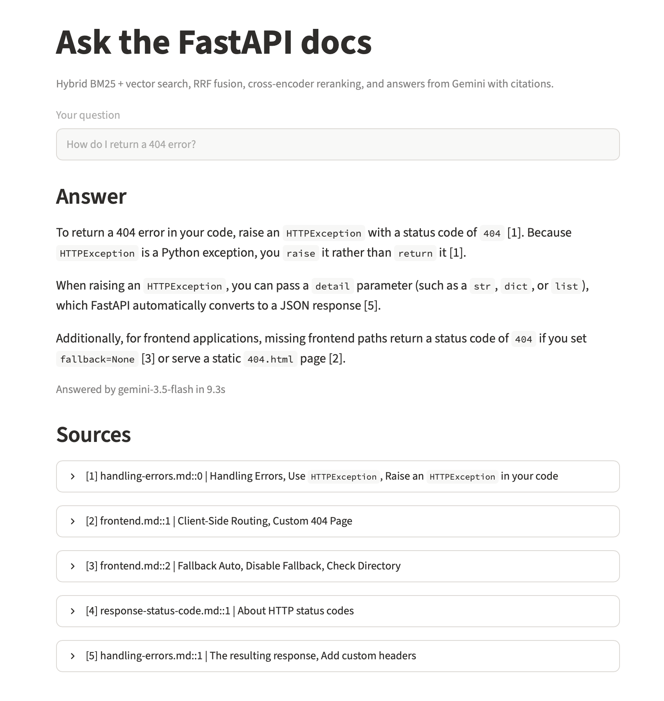

# Hybrid RAG with Reranking

A question-answering system over the FastAPI tutorial docs that combines keyword search (BM25) and semantic search (embeddings), merges them with Reciprocal Rank Fusion, reranks with a cross-encoder, and generates answers with citations using Gemini.



I built this to learn how retrieval actually works under the hood, so every piece (chunking, fusion, evaluation) is written from scratch instead of using a framework like LangChain.

## Results

Evaluated on 50 questions, each with a known correct chunk.

| System | Hit-rate@5 | MRR@10 | Avg latency |
|---|---|---|---|
| Vector only (baseline) | 70% | 0.489 | 8 ms |
| BM25 only | 74% | 0.529 | <1 ms |
| Hybrid (RRF) | 74% | 0.584 | 7 ms |
| Hybrid + MiniLM reranker | 76% | 0.580 | 175 ms |
| **Hybrid + bge reranker** | **80%** | **0.596** | 1,034 ms |

*Latency measured on a MacBook Air CPU, retrieval only (no LLM call).*

### What I found

- **Hybrid search beat vector-only at almost no cost.** MRR improved from 0.49 to 0.58, meaning the right chunk ranked noticeably higher, with no added latency.
- **The small reranker didn't help.** In error analysis, it pushed 5 correct results out of the top 5 that hybrid had ranked well, while fixing a similar number. It was trained on general web search, not technical docs.
- **A larger reranker did help**, raising hit-rate@5 to 80%, but at about 1 second per query. Since the LLM answer takes several seconds anyway, I think that's a reasonable trade for this use case, but not for an instant search box.
- **BM25 alone outperformed vector alone**, likely because the FastAPI docs are full of exact identifiers (`response_model`, `yield`) and because LLM-drafted questions tend to reuse document wording.

## How it works

1. **Chunking** (`src/chunk.py`): cleans Markdown (HTML tags, doc-specific markup), splits by headings while ignoring `#` inside code blocks, cuts oversized sections into 400-token windows with 50-token overlap, and merges small neighboring sections so chunks average about 295 tokens. 51 files become 225 chunks, each with a stable ID and source metadata.
2. **Vector search** (`src/build_vector_index.py`, `src/vector_search.py`): `BAAI/bge-small-en-v1.5` embeddings in a FAISS inner-product index. I switched from `all-MiniLM-L6-v2` after noticing its 256-token limit would truncate most of my chunks.
3. **Keyword search** (`src/bm25_search.py`): BM25 over lowercase word tokens.
4. **Fusion** (`src/hybrid_search.py`): Reciprocal Rank Fusion, score = Σ 1 / (60 + rank). Uses ranks instead of raw scores because cosine and BM25 scores are on different scales.
5. **Reranking** (`src/rerank_search.py`): `BAAI/bge-reranker-base` cross-encoder rescores the top 20 and keeps the best 5.
6. **Generation** (`src/answer.py`): Gemini answers using only the retrieved chunks, cites a source for every claim, and refuses when the context doesn't cover the question. Falls back through several models when one is overloaded.
7. **Evaluation** (`src/evaluate.py`): hit-rate@5, MRR@10, and latency for each setup.

## Evaluation set

The 50 questions (`data/eval/questions.jsonl`) were drafted by Gemini from 50 randomly sampled chunks (fixed seed for reproducibility), then I reviewed them and rewrote 10 that were too long, copied doc jargon, or asked two things at once. The original drafts are kept in `questions_draft.jsonl` for comparison.

## Known limitations

- **Code examples aren't in the chunks.** FastAPI stores examples in separate files referenced by `{* ... *}` includes, which I strip. Some questions whose answer lives mainly in code (e.g. parameter aliases) can't be found.
- **One correct chunk per question.** Some questions are answered by more than one chunk, so the metrics slightly undercount correct retrievals.
- **50 questions is small.** A 3-question difference is a real signal but not a strong one.

## Run it yourself

```bash
git clone https://github.com/Chandanaramesh-cr/hybrid-rag.git
cd hybrid-rag
python -m venv venv
source venv/bin/activate
pip install -r requirements.txt

# get the FastAPI tutorial docs
git clone --depth 1 https://github.com/fastapi/fastapi.git /tmp/fastapi
mkdir -p data/raw
cp -r /tmp/fastapi/docs/en/docs/tutorial data/raw/fastapi_tutorial

# build the chunks and the vector index
python src/chunk.py
python src/build_vector_index.py

# evaluate retrieval
python src/evaluate.py

# ask a question (needs a free Gemini API key in a .env file: GEMINI_API_KEY=...)
python src/answer.py "How do I run code after sending a response?"
```

## What I'd do next

- Pull the referenced code examples into chunks
- Grow the eval set and allow multiple correct chunks per question
- Add query rewriting for vague questions and metadata filters by doc section
- Try reducing reranker candidates from 20 to 10 to cut latency
